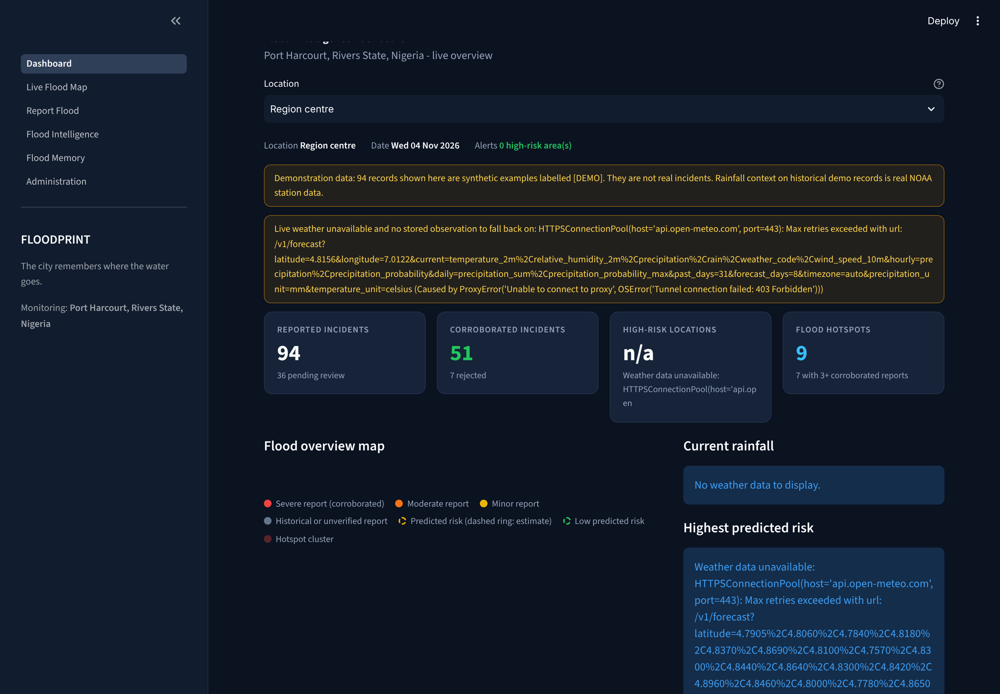
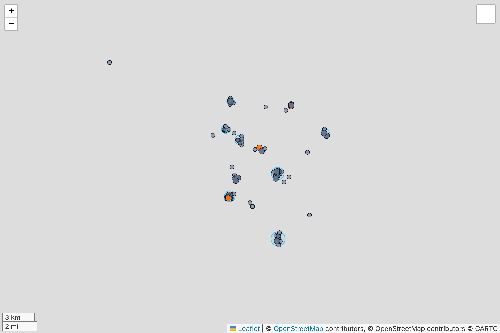
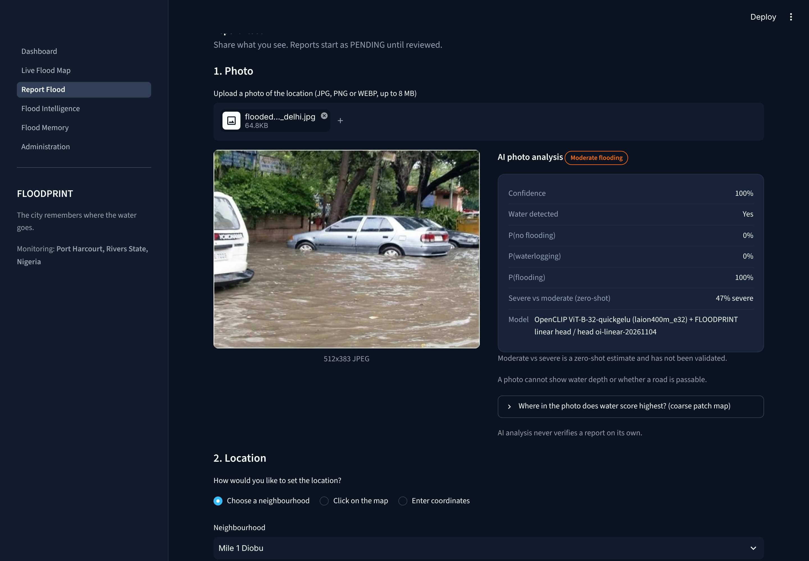
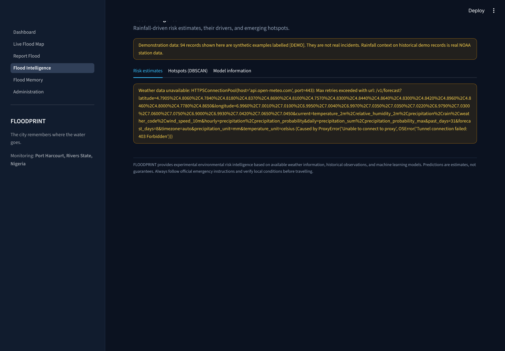
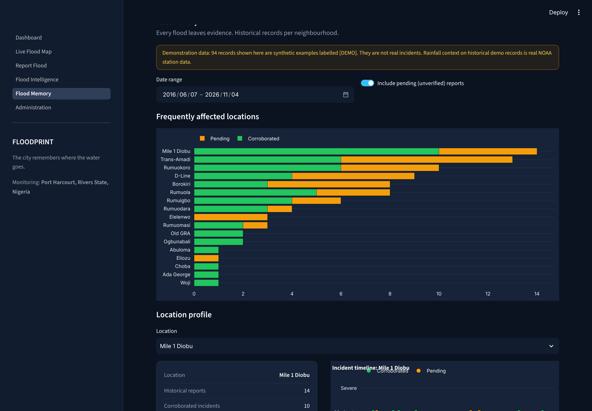
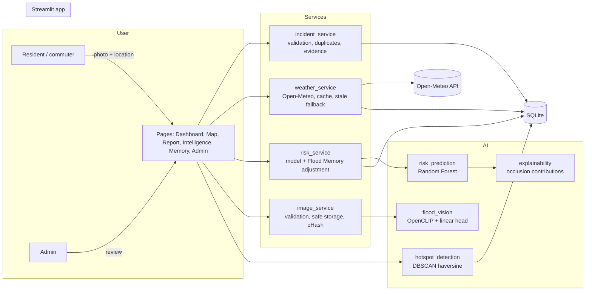
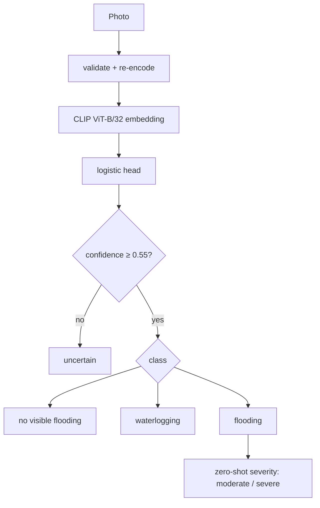

# FLOODPRINT

**The city remembers where the water goes.**

AI-powered community flood intelligence and early warning for Port Harcourt, Rivers State, Nigeria.

| | |
|---|---|
| **Hackathon** | Neural Storm 2026 |
| **Track** | Green Planet: Sustainability & Environmental Intelligence |
| **Problem statement** | **GP-03: Flood & Drought Early Warning System** (flood focus) |
| **Team name** | Neural Builders |
| **Team members** | Emediong Etuk, _add other members_ |
| **Primary language** | Python 3.11+ (all AI/ML in Python) |
| **Live demo** | https://floodprint-yy.streamlit.app |

> FLOODPRINT provides experimental environmental risk intelligence based on available weather information, historical observations, and machine learning models. Predictions are estimates, not guarantees. Always follow official emergency instructions and verify local conditions before travelling.

> **New: [FloodPrint Room](floodroom/README.md)** (Flip the Switch Hackathon). FloodPrint as an AI teammate inside the neighbourhood group chat, run by [Switch](https://github.com/sandbox-quantum/switch) and Claude Code. Residents report floods by message or photo, and the agent confirms them, answers "which road should I avoid?", and remembers every flood.

---

## 1. Problem

Urban flooding in Port Harcourt disrupts roads, homes and businesses every rainy season. Weather apps say *it will rain heavily*; they do not say which roads are already under water, which neighbourhoods flood again and again, or where responders should look first. Evidence of past floods (photos, posts, personal memory) is scattered and disappears when the water does.

## 2. Solution

FLOODPRINT turns individual flood observations into shared, lasting intelligence:

**Observe → Analyse → Remember → Predict → Alert**

1. A resident uploads a photo and location of a flood.
2. **Flood Vision** (computer vision) classifies the photo and shows where water scores highest.
3. The report is stored, checked for duplicates and quality issues, and reviewed by an administrator.
4. Corroborated reports build each neighbourhood's **Flood Memory**.
5. A **risk model** combines live Open-Meteo rainfall (past 30 days and 7-day forecast) with season, elevation and the regional flood record.
6. **DBSCAN** finds emerging hotspots where reports cluster.

## 3. Features

| Module | What it does | Status |
|---|---|---|
| Flood Vision | OpenCLIP ViT-B/32 image encoder + classifier head trained on human-verified Open Images photos → *no visible flooding / waterlogging / moderate / severe / uncertain*, confidence, class probabilities, coarse 3×3 water map | Trained and evaluated |
| Community reporting | Photo upload (JPG/PNG/WEBP, ≤ 8 MB, verified by content), neighbourhood / map-click / coordinate location, severity, description, incident ID on submit | Working |
| Verification | PENDING → CORROBORATED / REJECTED by admin; duplicate detection (distance + time + perceptual hash); timestamp, geographic and photo-GPS checks; rule-based evidence score | Working |
| Live Flood Map | Folium map: observed reports (solid dots), predicted risk (dashed rings), hotspots, history; filters for period, severity, status; click for location details | Working |
| Rainfall & risk | Open-Meteo current + hourly + daily (31 days past, 7 days forecast), Random Forest risk with per-location explanation | Working; model performance is modest (see §10) |
| Flood Memory | Per-neighbourhood history, timeline, rainfall association, frequency, comparison | Working |
| Hotspots | DBSCAN (haversine), separate corroborated-only and all-report clusters, configurable radius and minimum size | Working |
| Administration | Password-protected review queue, model status, system statistics, delete demo data | Working |

## 4. Screenshots

| Dashboard | Map layers: incidents + DBSCAN hotspots |
|---|---|
|  |  |
| **Report Flood (AI analysis)** | **Flood Intelligence** |
|  |  |
| **Flood Memory** | **Model information** |
|  |  |

_Screenshots were taken in a build sandbox that could not reach Open-Meteo, the map tile servers or the Leaflet/jQuery CDNs. Live-weather panels therefore show their "unavailable" state (the designed fallback), the in-app map component did not render, and the map image above is the same Folium map object rendered on its own, without tiles. In a normal browser with internet access, tiles, maps and live weather load as usual. The photo is "Flooding in the streets of New Delhi" by NRDC pix, CC BY 2.0 (see `assets/samples/ATTRIBUTION.md`), from the vision model's held-out test split._

## 5. System architecture





Code layout:

```text
app.py                 navigation + theme
pages/                 6 Streamlit pages
ai/                    flood_vision, risk_prediction, hotspot_detection, feature_engineering,
                       model_training, explainability
services/              weather, geocoding, image, incident, risk, demo data
database/              schema (models.py), connection, repository (all SQL)
components/            theme, maps, cached state
config/regions/        region JSON (switch city without code changes)
scripts/               download data, build datasets, train, seed, initialise DB
data/models/           trained heads/models + metrics JSON (committed, small)
tests/                 56 pytest tests
```

### Database

SQLite with tables `incidents`, `weather_observations`, `risk_predictions`, `hotspots`, `location_history` (+ `schema_meta`). Indexed on coordinates, timestamps, status and location. Images are stored as files under `data/uploads/` with random names; only the relative path is stored. `location_history` is maintained automatically: an incident enters it when corroborated and leaves it if rejected. Demo rows carry `is_demo = 1`. See `database/models.py`.

## 6. AI / ML implementation

### 6.1 Flood Vision

- **Backbone:** OpenCLIP `ViT-B-32-quickgelu`, pretrained on LAION-400M (`laion400m_e32`), downloaded from the OpenCLIP GitHub release with checksum verification, frozen.
- **Head:** multinomial logistic regression on L2-normalised 512-d embeddings, `class_weight="balanced"`, C = 30 picked by 5-fold CV on the training split.
- **Training data:** 1,562 Google Open Images V7 photos with **human-verified** labels:
  - `flooding`: Flood label verified present (187)
  - `waterlogging`: Puddle verified present, Flood not (99)
  - `no_flooding`: Flood verified *absent* (hard negatives such as rivers, lakes, rain) plus street/road/residential scenes (1,276)
- **Severity (moderate vs severe):** zero-shot CLIP prompt comparison. **Not validated**, and labelled as such in the UI.
- **Water map:** the head is applied to 9 overlapping crops. This is a coarse indicator, not segmentation.
- **Safeguards:** below 55% confidence the result is *uncertain*; the UI states that photos cannot show depth or passability; AI output never changes verification status; if weights cannot load, the UI shows "analysis unavailable" (no fallback result).

### 6.2 Flood risk model

- **Target (defined before training):** probability that a large flood recorded by the Dartmouth Flood Observatory (DFO) **begins within the next 7 days** in an area covering the location (event radius = equal-area circle of the reported affected area, clipped to 50–300 km).
- **Data:** NOAA GSOD daily rainfall, 102 quality-checked stations in West/Central Africa (1995–2021; station-years need ≥ 85% coverage and ≥ 200 mm/yr). Rainfall is averaged over stations within 100 km. Labels come from 186 DFO events in the region.
- **Features (14):** rainfall today and over the last 3/7/14/30 days, heaviest day in the last 7, wet days, forecast rainfall over the next 3/7 days, heaviest forecast day, season (sin/cos of day-of-year), elevation, and DFO floods nearby in the previous 5 years.
- **Model:** Random Forest (300 trees, depth 8, min leaf 300, balanced subsampling) with Platt calibration on the validation years. Chosen with rolling-origin validation **before** the test period was evaluated.
- **Live inference:** Open-Meteo past-31-day and 7-day-forecast daily totals, plus elevation from Open-Meteo. The DFO archive ends in Oct 2021, so the "recent floods" feature uses its last 5 years.
- **Flood Memory adjustment (rule-based, not learned):** odds × exp(0.35·ln(1+corroborated) + 0.10·ln(1+pending)) for reports within 750 m in the last 3 years, capped at 95%. Shown separately from the model probability.
- **Explainability:** per-prediction occlusion contributions (each feature reset to its training median) and global permutation importance. Explanations are generated only from these numbers.
- **Risk bands:** Low 0–20%, Moderate 21–45%, High 46–70%, Very High 71–100%. These are interface thresholds, not calibrated warning levels.

### 6.3 Hotspot detection

DBSCAN on radians with the haversine metric (eps 450 m, min 3 reports by default, adjustable in the UI). Rejected reports are excluded. "Corroborated-only" and "corroborated + pending" clusters are computed and displayed separately. Each hotspot reports centre, radius, count, unique locations, severity distribution, verification mix, and first/last report.

## 7. Technology stack

Python 3.11+, Streamlit, Pandas, NumPy, scikit-learn (Random Forest, logistic regression, DBSCAN, isotonic/Platt), XGBoost (comparison), PyTorch + OpenCLIP (vision), Pillow + ImageHash, Folium + streamlit-folium, Plotly, SQLite, Joblib, Requests, Pytest.

## 8. Data sources

| Data | Source | Licence / terms | Used for |
|---|---|---|---|
| Live and forecast weather | [Open-Meteo](https://open-meteo.com) forecast API | CC BY 4.0, free non-commercial use | Live risk, rainfall context |
| Daily station rainfall | NOAA GSOD via `s3://noaa-gsod-pds` | US public domain | Risk training; Port Harcourt rainfall history |
| Flood events | DFO Global Active Archive of Large Flood Events, G.R. Brakenridge, Univ. of Colorado (`FloodArchive.xlsx`, 1985–2021, from a public GitHub mirror) | Free for research use with attribution | Risk labels; recent-flood feature |
| Flood photos | Google Open Images V7 human-verified labels; images from the public S3 mirror | Annotations CC BY 4.0; images CC BY 2.0 (per author) | Vision head training and evaluation. Only image IDs are committed (`data/processed/vision_dataset_manifest.csv`) |
| Vision backbone | [OpenCLIP](https://github.com/mlfoundations/open_clip) ViT-B/32 LAION-400M | MIT (code), released weights | Image embeddings |
| Basemap | OpenStreetMap tiles (default), Esri World Imagery (optional) | ODbL / Esri terms of use | Map display |
| Neighbourhoods | Approximate centroids of 18 Port Harcourt areas (`config/regions/port_harcourt.json`) | — | Monitoring points; not surveyed boundaries |

## 9. Demonstration data

The app works with an empty database. For demos it seeds **clearly labelled** records on first start (`FLOODPRINT_SEED_DEMO=true`):

- 94 synthetic incidents marked `is_demo = 1`, with descriptions starting `[DEMO]` and a banner on every page that shows them.
- Historical demo incidents are placed on days when the **real** Port Harcourt Intl station (NOAA GSOD 65250) recorded ≥ 30 mm of rain, and carry that real rainfall as context. The incidents themselves are invented.
- **No AI results are fabricated:** demo incidents have no photo and no AI classification.
- Administrators can delete all demo data with one button, or run `python scripts/seed_demo_data.py --reset`.

## 10. Model evaluation (honest results)

All numbers below are copied from `data/models/vision_metrics.json` and `data/models/risk_model_metrics.json`, produced by the training scripts in this repo.

### 10.1 Flood Vision (3 classes)

| Evaluation | n | Accuracy | Macro-F1 | Flood precision | Flood recall | Flood F1 | Flood ROC-AUC |
|---|---|---|---|---|---|---|---|
| **5-fold CV, all images** | 1,562 | **0.899** | **0.800** | 0.715 | **0.872** | 0.786 | 0.977 |
| Held-out test split (15%) | 235 | 0.898 | 0.784 | 0.774 | 0.800 | 0.787 | 0.974 |
| Zero-shot CLIP prompts (baseline) | 1,562 | 0.667 | 0.573 | 0.343 | 0.930 | — | — |

- 95% bootstrap CI (CV): flood recall 0.82–0.92, macro-F1 0.77–0.83.
- CV confusion matrix (rows = truth: no flooding / waterlogging / flooding): `[[1167, 45, 64], [24, 74, 1], [23, 1, 163]]`. 23 of 187 floods (12%) were classed as "no flooding" (false negatives).
- Per class (CV): no flooding F1 0.94, waterlogging F1 0.68 (precision 0.62, the weakest class), flooding F1 0.79.
- The trained head beats zero-shot prompting by about 0.23 macro-F1. Zero-shot has higher flood recall but labels many dry water scenes as floods.
- **Limits:** Open Images photos are global and mostly not Nigerian street scenes. The moderate/severe split is unvalidated. No segmentation metric (IoU) is reported because no pixel masks were trained.

### 10.2 Flood risk model (DFO large-flood onset within 7 days)

Chronological split: train 1995–2012 (190,387 station-days, 351 positives), validation 2013–2016 (87,730 / 77), **test 2017-01 to 2021-09 (116,577 / 230; prevalence 0.20%)**.

| Model (test period) | ROC-AUC | PR-AUC | Brier skill vs base rate | Recall @ threshold | Precision @ threshold |
|---|---|---|---|---|---|
| **Random Forest (deployed)** | 0.758 | 0.0045 | +0.0006 | 0.022 | 0.014 |
| XGBoost, monotone rain constraints | **0.776** | **0.0102** | +0.0011 | 0.074 | 0.017 |
| Climatology baseline (season + flood record + elevation) | **0.799** | 0.0053 | +0.0013 | 0.243 | 0.007 |

Rolling-origin validation (used for model selection): RF ROC-AUC 0.820 / 0.772 and PR-AUC 0.0092 / 0.0110, against climatology 0.792 / 0.833 and 0.0064 / 0.0031 (folds ending 2012 and 2016).

What this means:

- **The risk model has limited skill.** It ranks flood-onset days better than chance (ROC-AUC 0.76) but **does not beat a seasonal baseline** on the test period. Its decision threshold (chosen on validation to favour recall) catches only 2% of test onsets, so **false negatives are very high**. XGBoost did better on the test period. It was not swapped in after the fact, to avoid tuning on test data; this is listed as future work.
- Permutation importance on test: season, forecast rainfall (heaviest day, 7-day total) and 30-day rainfall matter most. Several short-window rainfall features add nothing out of sample.
- Leave-Nigeria-out spatial check (no Nigerian station in training): ROC-AUC 0.986, but with **only 6 positives** across 6 stations, so it is not conclusive.
- The Port Harcourt station had 266 usable test-period days and 0 onset labels, so **there is no Port Harcourt-specific validation**.
- **Why:** DFO records large, regional floods with approximate dates, not street flooding, and gauges in the region are sparse and gappy. Training used observed future rainfall in place of forecasts ("perfect forecast" hindcast), so live skill will be lower.
- **Not validated** for street-level flooding in Port Harcourt. The interface says this next to every estimate.

### 10.3 Software tests

`python -m pytest`: **56 tests pass**, covering vision (valid, invalid, corrupt and oversize images, path traversal, model unavailable, real CLIP inference), weather (success, missing data, timeout, stale fallback, invalid coordinates, cache), prediction (loading, valid and missing features, band mapping, end-to-end risk service), hotspots (clusters, isolated points, empty data, invalid coordinates, scopes) and incidents (create, retrieve, verify, duplicates, 8 invalid-submission cases).

## 11. Installation

```bash
git clone https://github.com/emediong-etuk/floodprint.git
cd floodprint
python -m venv .venv && source .venv/bin/activate
pip install -r requirements.txt
cp .env.example .env    # then set FLOODPRINT_ADMIN_PASSWORD
```

## 12. Configuration

| Variable | Default | Purpose |
|---|---|---|
| `FLOODPRINT_ADMIN_PASSWORD` | _(unset → admin disabled)_ | Admin page password. Never commit it. |
| `FLOODPRINT_REGION` | `port_harcourt` | Region file in `config/regions/` |
| `FLOODPRINT_SEED_DEMO` | `true` | Seed labelled demo data into an empty DB |
| `FLOODPRINT_DB_PATH` | `data/floodprint.db` | SQLite path |
| `FLOODPRINT_VISION_THRESHOLD` | `0.55` | Below this, photos are "uncertain" |
| `FLOODPRINT_HOTSPOT_EPS_M` / `_MIN_SAMPLES` | `450` / `3` | DBSCAN settings |
| `FLOODPRINT_WEATHER_TTL_S` | `900` | Weather cache lifetime |
| `FLOODPRINT_VISION_WEIGHTS` | _(auto)_ | Path to pre-downloaded OpenCLIP weights |

To monitor another city, add `config/regions/<city>.json` (centre, bounding box, neighbourhood points, timezone) and set `FLOODPRINT_REGION`.

## 13. Running locally

```bash
python scripts/initialize_database.py   # optional: the app also does this
streamlit run app.py
```

The first photo analysis downloads the OpenCLIP weights (~605 MB) to `data/models/openclip/`.

Reproduce the models (optional; trained artefacts are already committed):

```bash
python scripts/download_risk_data.py     # DFO + NOAA GSOD (~1 min)
python scripts/train_model.py            # risk model + metrics (~1 min)
python scripts/build_vision_dataset.py   # Open Images labels + images (~3 min)
python scripts/train_vision_head.py      # embeddings + head + metrics (~2 min on CPU)
python -m pytest
```

## 14. Deployment

Streamlit Community Cloud:

1. Make this repository public. Then, at share.streamlit.io, choose **New app**, select the repository, branch, and `app.py`.
2. In **Advanced settings → Secrets**, add `FLOODPRINT_ADMIN_PASSWORD = "..."`.
3. Python 3.11–3.13 works. `requirements.txt` uses the PyTorch CPU wheel index to keep the image small.

Notes:

- The app creates its database and demo data on first start.
- **Storage is not persistent on Streamlit Community Cloud:** SQLite and uploaded photos can be lost on redeploy or restart. For real use, move to a hosted database and object storage.
- The vision model downloads on first use (~30–60 s). The outbound hosts needed are `api.open-meteo.com`, `github.com` (weights), and the map tile servers in the browser.

## 15. Known limitations

- The risk model shows limited skill and has not been validated for street flooding in Port Harcourt (see §10.2).
- The vision model was trained on global photos and has not been tested on a Port Harcourt photo set. Its severity split is unvalidated, and it cannot judge depth or passability.
- Neighbourhood coordinates are approximate. Live rainfall is gridded model data (Open-Meteo), not gauge data, so nearby neighbourhoods usually get the same rainfall.
- The Flood Memory risk adjustment uses fixed constants, not learned values.
- Admin authentication is a single shared password (fine for an MVP, not for production).
- Demo incidents are synthetic. Real use needs real community reports.

## 16. Future improvements

- Collect labelled Port Harcourt street-flood reports and retrain the risk model on them (the pipeline is ready).
- Switch to monotone XGBoost if it holds up on new data; add drainage, land-cover and DEM-derived low-lying features.
- Fine-tune vision on local photos; add real water segmentation with IoU evaluation.
- Route accessibility, SMS/WhatsApp alerts, automated corroboration, persistent cloud storage.

## 17. AI development tools disclosure

This project was built with **Claude Code (Anthropic)**, an AI coding assistant. It wrote most of the code, data pipelines, tests and this README under the team's direction. All model metrics come from the training and evaluation scripts in this repository. None were written by hand.

## 18. Licence

MIT. See `LICENSE`. Third-party data and model weights keep their own licences (see §8).
